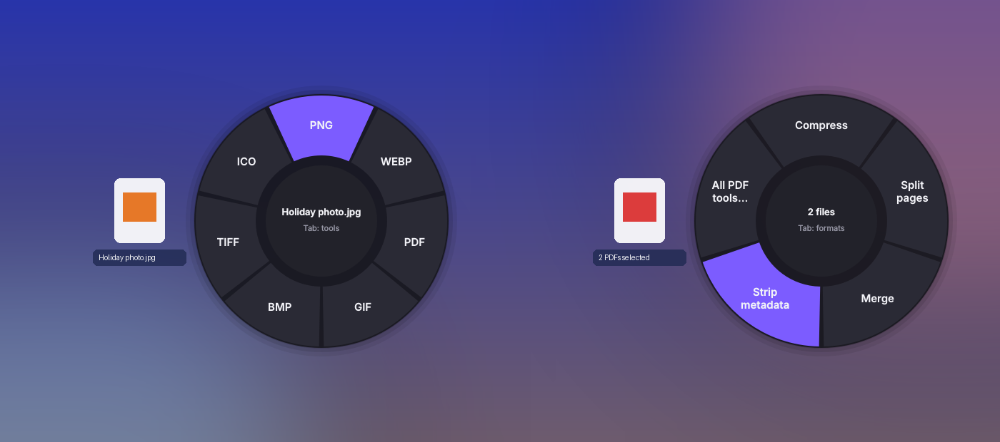
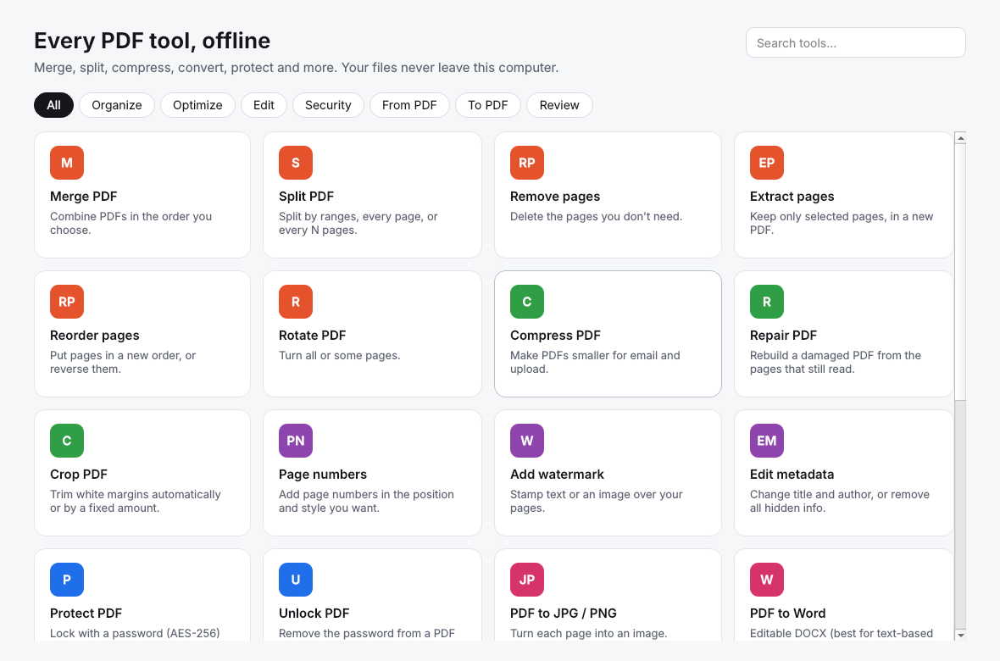
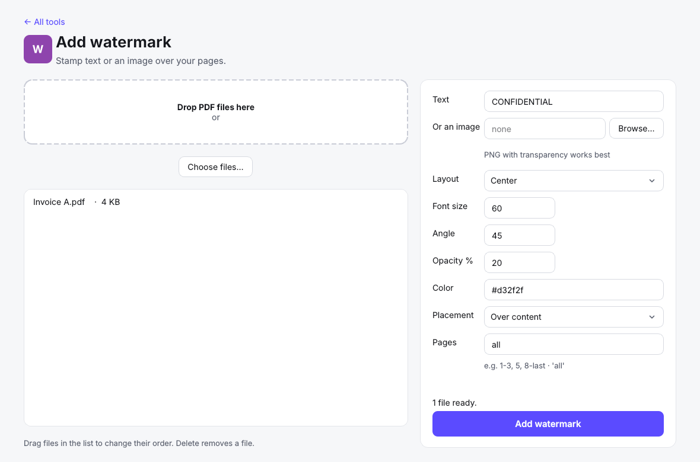
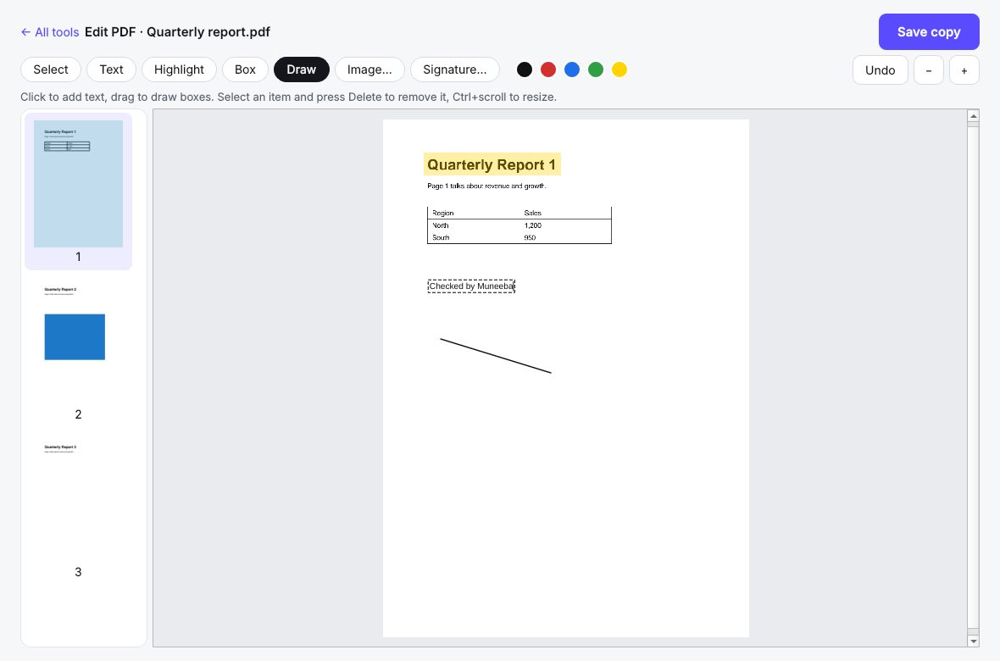

<div align="center">


# Swirl

**Every PDF and file tool you need, on your own computer.**
Merge, split, compress, convert, sign, redact and more — for Ubuntu and Windows.
Nothing is uploaded: your files never leave your machine.

</div>



## Two ways to work

**The wheel, for quick jobs.** Right-click files → *Convert with Swirl*, and a wheel of formats
opens at your pointer. Click one and the converted copy is saved next to the original. Press
**Tab** (or right-click) for tools such as compress, merge and strip metadata. Selecting a mix,
such as a Word file and two PDFs, offers *PDF* and *Merge into one PDF*.
Prefer drag and drop? Run the **Swirl Bubble** and drop files on it.

**Swirl Studio, for everything else.** A full PDF toolkit in one window: pick a tool, drop files,
set the options, done.



| Tool settings | Edit, sign and redact on the page |
|---|---|
|  |  |

## What it can do

| Area | Tools |
|---|---|
| **Organize** | Merge · Split (ranges, every page, every N pages) · Organize pages visually (drag, rotate, delete, insert blank) · Remove pages · Extract pages · Reorder · Rotate |
| **Optimize** | Compress (light / recommended / extreme — never returns a bigger file) · Repair · Crop (auto-trim white margins) · OCR scanned PDFs |
| **Edit** | Edit PDF (text, highlight, boxes, drawing, images) · Sign (draw, type or upload — paper background removed) · Page numbers · Watermark (text or image, centred or tiled) · Fill forms · Edit or wipe metadata |
| **Security** | Protect (AES-256, limit printing / copying / editing) · Unlock · Redact (flattens marked pages so hidden text is really gone) |
| **From PDF** | JPG / PNG · Word · PowerPoint · Excel (tables become sheets, numbers stay numbers) · Markdown · Text · Extract images · PDF/A |
| **To PDF** | JPG and other images · Word · PowerPoint · Excel · HTML |
| **Review** | Compare two PDFs page by page (text changes and visual changes) |
| **Wheel conversions** | Images (PNG, JPG, WebP, GIF, BMP, TIFF, ICO, PDF) · Video (MP4, WebM, MOV, GIF, MP3, compress, remove audio) · Audio (MP3, WAV, OGG, FLAC, M4A) · Documents (PDF, DOCX, ODT) · Markdown and HTML |

Results are always saved **beside the originals** with a new name (`report-compressed.pdf`,
`photo (1).png`, …). Swirl never overwrites or changes your files.

## Install

Download the installer for your system from the
[latest release](https://github.com/anascs12/swirl/releases/latest).

### Ubuntu (22.04 and newer)

```bash
sudo apt install ./swirl_0.1.4_amd64.deb     # also suggests FFmpeg, LibreOffice and Pandoc
swirl --install                              # adds "Convert with Swirl" under Scripts in the right-click menu
```

Open **Swirl Studio** from the app menu. In Files, right-click a file → **Open With… → Swirl Studio**
(or *Convert with Swirl* for the wheel). After `swirl --install` there is also **Scripts → Convert
with Swirl** (restart Files once with `nautilus -q`); in Nemo and Dolphin it is in the main menu.
For OCR, also run `sudo apt install tesseract-ocr`.

### Windows 10 and 11

Run **SwirlSetup-0.1.4.exe**. It adds *Convert with Swirl* to the right-click menu (on Windows 11,
under *Show more options*) and to *Send to*. Video and audio conversions need FFmpeg
(`winget install Gyan.FFmpeg`), Office conversions need [LibreOffice](https://www.libreoffice.org/),
OCR needs [Tesseract](https://github.com/UB-Mannheim/tesseract/wiki).

Run `swirl --check` to see which optional engines are installed. Tools that need a missing engine
are shown with a note instead of failing.

## Command line

```bash
swirl                                   # open Swirl Studio
swirl --tool merge a.pdf b.pdf          # open a Studio tool with files loaded
swirl photo.jpg                         # open the wheel for a file
swirl --bubble                          # floating drop target
swirl --list                            # every PDF tool and its options
swirl --run compress report.pdf --set level=Extreme
swirl --run protect report.pdf --set password=s3cret --set confirm=s3cret
```

## Development

```bash
python3 -m venv .venv && . .venv/bin/activate
pip install -e ".[dev]"
python -m pytest            # 60 tests: engine, toolkit, editor, Studio and wheel
python -m swirl             # run from source
```

Builds: `packaging/linux/build_deb.sh` makes the `.deb`; on Windows, PyInstaller with
`packaging/swirl.spec` and then Inno Setup with `packaging/windows/swirl.iss`.
GitHub Actions runs the tests on Ubuntu and Windows on every push, builds both installers,
and publishes them as the GitHub release for the version in `swirl/__init__.py`.

## Contributing

Issues and pull requests are welcome. Run `python -m pytest` before sending a change; GitHub Actions
runs the same tests on Ubuntu and Windows. If Swirl crashes, the reason is written to
`~/.cache/swirl/swirl.log` (Windows: `%LOCALAPPDATA%\Swirl\swirl.log`); please attach its last lines.

## Contributors

| | |
|---|---|
| [Anas Khan](https://github.com/anascs12) | Creator, PDF toolkit and packaging |
| [Muneeba Saleem](https://github.com/muneebacs12) | Co-creator, testing and design |

## License

[MIT](LICENSE). Free to use, change and share, including commercially.

## Privacy

All processing happens locally. Swirl has no network code, accounts, telemetry or uploads.

## Third-party software

Swirl is built on open-source libraries, all compatible with its MIT licence:
Qt for Python / PySide6 (LGPL-3.0, dynamically linked), Pillow (MIT-CMU), pypdf (BSD-3),
pypdfium2 and PDFium (Apache-2.0 / BSD-3), reportlab (BSD), python-pptx (MIT), pdfplumber and
pdfminer.six (MIT), openpyxl (MIT), cryptography (Apache-2.0 / BSD).
FFmpeg, LibreOffice, Pandoc, Tesseract and Ghostscript are separate programs that Swirl runs if
they are installed; they are not bundled.
